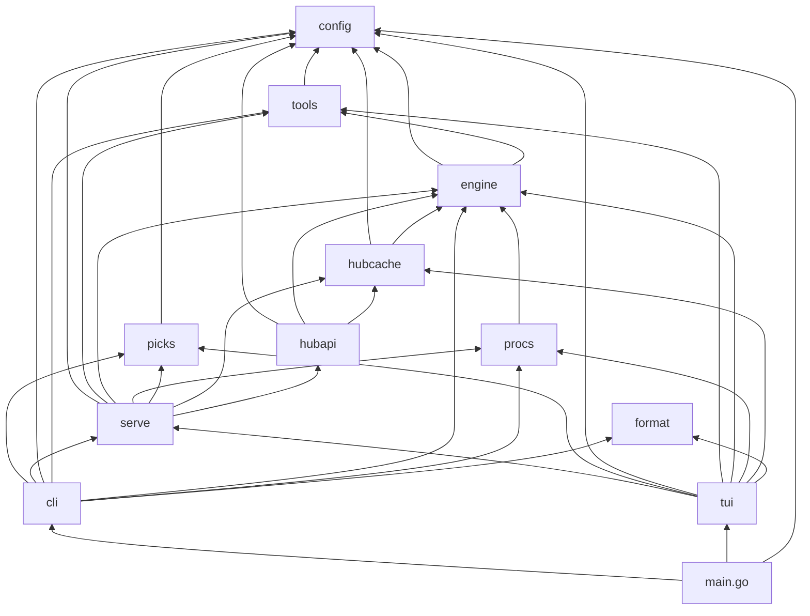
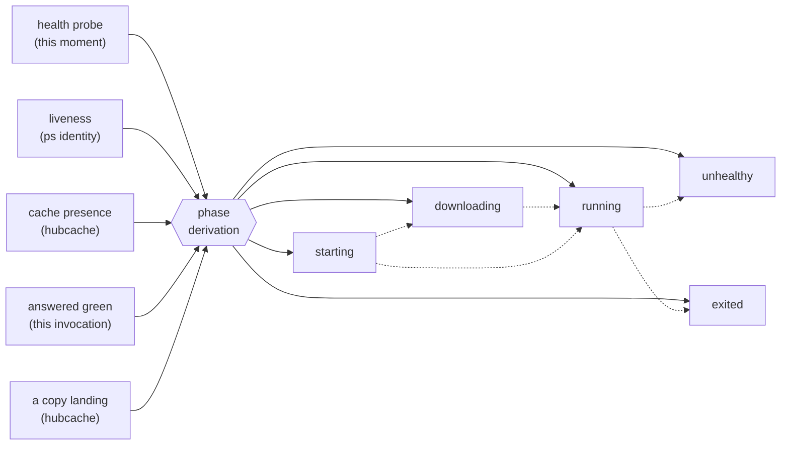

# Architecture

> The system's shape: processes, subsystems and their boundaries, data flow, where state
> lives, how it runs. It names a technology only to describe the shape. The contracts
> live in `docs/specs/`; this document points at them rather than repeating them.

## Run shape

- **A local tool with no listener of its own.** Bare `cria` opens the TUI; the
  subcommands drive the same subsystems scriptably (`docs/specs/CLI.md`). `install.sh`
  puts the binary in `~/.local/bin`, and `cria update` replaces it (`AGENTS.md`,
  Deployability).
- **No daemon** (`docs/cria.md`, principle 3). cria spawns servers detached, in their
  own session: cria may exit at any moment, and the next invocation re-attaches by
  reading its state records back. Closing the TUI stops nothing.
- The host provides `llama-server`, `mlx_lm.server`, `vllm` and `hf`. cria detects them,
  reports what a missing or unfit one disables, and installs nothing.

## State

cria writes to exactly two trees and reads a third it does not own:

| tree | who writes it | what is in it |
| --- | --- | --- |
| `~/.config/cria/` | people and coding agents; cria creates the root, `models/` and `AGENTS.md` when missing | `config.toml`, one `models/<id>.toml` per launchable entry, one `engines/<engine>.toml` per engine |
| `~/.local/state/cria/` | cria alone | `servers/<id>.json` state records, `logs/<id>-<stamp>.log` (newest `logs_kept` per entry, default 3), `choices.json` picks, `engines/<engine>/` for state that belongs to an engine rather than an entry, `ui.json` UI memory |
| `~/.cache/huggingface/hub/` | `hf` and the servers; cria only through a delete plan | every model byte on the host — the single source of truth |

- **Fixed paths, the same on macOS and Linux** (settled 2026-08-18): neither
  `~/.config/cria/` nor `~/.local/state/cria/` consults the XDG variables. Both trees are
  cria's own, and half of its files moving with a variable while the other half stays put
  is worse than neither moving. Rejected: platform-native directories such as
  `~/Library/Application Support`.
- **UI memory is machine-owned state** (settled 2026-08-18): it lives in `ui.json`, never
  in the config tree.
- **cria's own state carries no shape version, and nothing migrates it**
  (CODING-RULES §16, `[PROJECT]`): it is disposable memory.
- **State records are how cria re-attaches**: scan the records, verify the pid is the
  process recorded and the port answers, and flag the rest stale.
- Config decodes strictly into typed structs, then explicit validation (CODING-RULES
  §4); `config.Load` reports the files it refused.
- The HF token comes from `hf`'s token file and reaches the servers cria launches in
  `HF_TOKEN`, never on a command line (CODING-RULES §9).

**State is per entry, except where it is per engine** (settled 2026-08-31). Most
of what cria writes belongs to an entry — its record, its logs, the option picked
on each of its axes. What belongs to an *engine* — a server the whole tree shares
rather than one entry's — lives in a folder of its own, so nothing an entry is
named can collide with it:

```
~/.local/state/cria/
├── servers/<entry-id>.json          one record per entry's running server
├── logs/<entry-id>-<stamp>.log      newest logs_kept per entry
├── choices.json                     the option picked on each entry's axes
├── ui.json                          the TUI's own memory
└── engines/router/                  the one engine that has state of its own
    ├── models.json                  which entries it holds, and under what
    ├── preset.ini                   composed at every start, never edited
    ├── server.json                  its record
    └── logs/router-<stamp>.log      newest logs_kept
```

Entry records and logs stay where they are: an entry's server is still an
entry's, and moving them under `engines/llama/` would be a rename with no
question behind it. The router's logs sit under its own folder so an entry named
`router` can neither prune them nor be pruned by them.

The HF cache is huggingface_hub's, so cria resolves it the way the library does
(`HF_HUB_CACHE`, then `HF_HOME`, then the XDG cache directory) and reads exactly the
tree the tools write.

## Background work

- **Mechanism is decoupled from trigger.** Any background or maintenance mechanism is an
  invocable unit; its triggers (boot, a schedule, a debounce, an event, a manual run) are
  wired separately, and any trigger can invoke any mechanism. A manual run always works,
  for testing or because it is needed now. Record for every execution what triggered it,
  when, and the result.
  - In cria: the router loads a model on the first request that names it, and
    `cria router load` / `unload` make that mechanism invocable on its own. The TUI
    re-reads the config tree and observes the servers once per tick.

## Repo layout & subsystem boundaries

- One Go module; `main.go` in the root does the wiring and nothing else: it scaffolds the
  config tree and hands the command line to `cli`, passing `tui.Run` as the program bare
  `cria` opens. Subsystems are a **flat list** of packages under `internal/`, one per
  subsystem. A package's exported identifiers are its entry point, and the compiler
  rejects import cycles, so the lint only fences capabilities (CODING-RULES §7).
- The graph is acyclic and layered: leaves that only read the world, then the lifecycle
  over them, then the two faces. The "may import" column below is the intended fence;
  nothing checks it yet (`docs/BACKLOG.md`, Code against the rules).
- **A subsystem is reached through its entry point and nothing else.** Composing
  two of them — where the config tree lives *and* where the cache lives — is the
  caller's wiring, not a subsystem's business.
- **Judgement belongs to the layer that owns the question.** `procs` reports what
  the operating system said; `serve` decides live versus exited. `hubcache` and
  `tools` report data; `cli` and `tui` decide how it reads.
- **Per-engine knowledge lives in one place.** `engine` answers what differs
  between ways of serving — the program to run, how a model is named on its
  command line, which endpoints it publishes, whether a green server has loaded
  its weights — and does none of it: `serve` spawns, probes and requests.
  Everything else asks rather than branching, and the lookup refuses a backend no
  engine claims instead of defaulting to one. What "already downloaded" means is
  the same kind of question, so `hubcache` and `hubapi` ask it too (settled
  2026-08-31): a reference qualified by a quantization is one file set out of a
  repo, one that is not is the whole repo.
- **An engine knows, it never acts** (settled 2026-08-31, the boundary as three
  implementations left it). The interface is paths, predicates and composition —
  id, program, tool, model args, quant rule, health path, lazy-load, slots path —
  and every transport stays a `serve.Manager` field: spawn, probe, complete,
  slots, bench, and the router's two (one listing read, one load/unload sender).
  The router proved the boundary rather than bending it: it composes a preset file
  where the others compose argv, and it names its own endpoints and states, but
  the requests to them are `serve`'s like all the others. That is what keeps an
  engine implementable by something that is not a process at all.
- **Not every engine is a backend an entry may declare** (settled 2026-08-31).
  `config.Engines()` is what the tree may configure — engine files, records,
  display; `config.Backends()` is the narrower set an entry's `backend` key may
  name. The router is in the first and not the second: it runs **one server for
  the host**, serving models that are ordinary entries, so what makes an entry the
  router's lives in state rather than in the tree.
- **The per-backend schema metadata stays in `config`** (settled 2026-08-31).
  `engine` imports `config`, so the keys a backend takes and the example values
  it takes them at cannot be declared with the engines without a cycle; `config`
  owns that registry and the enum, and `engine`'s own test holds the two sets to
  being one. Display is the mirror case: which colour an engine's name is drawn
  in and which order the toggle walks are `tui` decisions keyed by engine id —
  an engine module renders nothing.

## Subsystems

| package | what it owns | entry point | may import |
| --- | --- | --- | --- |
| `internal/config` | the config tree, its schema, the schema's own documentation, and how an args list pairs into flag groups (`specs/CONFIG.md`) | `Load(root)`, `FlagGroups(args)` | — |
| `internal/format` | how a size, a duration and a Hub reference are spelled | `Bytes`, `HubReference`, … | — |
| `internal/tools` | which managed programs the host has and what each one's state disables (`specs/TOOLS.md`) | `Check(settings)` | `config` |
| `internal/engine` | what cria knows about each way of serving — llama, mlx, vllm and the router: the program, the model reference, the endpoints, the warm and slot rules, and the router's preset composition (`specs/SERVE.md`) | `For(backend)`, `All()`, `RouterPreset` | `config`, `tools` |
| `internal/procs` | every `ps`/`lsof` exec and every signal cria sends (`specs/SERVE.md`) | `System{}` (a `Host`) | `engine`, `tools` |
| `internal/picks` | what has been chosen: the option picked on each entry's axes, and which entries the router holds and under what (`specs/CONFIG.md`) | `Load`/`Save`, `LoadRouter`/`SaveRouter` | `config` |
| `internal/hubcache` | the cache walk, true blob-deduped sizes, entry presence, and the delete plans — carried out by cria, or by `hf cache rm` where hf's shared blob store holds the bytes (`specs/CACHE.md`) | `Read(root)`, `Plan*`/`Execute` | `config`, `engine` |
| `internal/hubapi` | what a model comes to when complete, and the HF token | `New()`, `Token()` | `config`, `engine`, `hubcache` |
| `internal/serve` | a managed server's life: compose, spawn detached, record, observe, stop (`specs/SERVE.md`) | `New(root, host)` | `config`, `tools`, `engine`, `procs`, `picks`, `hubcache`, `hubapi` |
| `internal/cli` | parsing, ordering and output for the subcommands (`specs/CLI.md`) | `Dispatch(args, version, tui)` | `config`, `tools`, `engine`, `procs`, `picks`, `serve`, `format` |
| `internal/tui` | the program frame and its screens (`specs/TUI.md`) | `Run()` | `config`, `tools`, `engine`, `procs`, `picks`, `serve`, `hubcache`, `format` |

`serve` never imports `hubcache`'s delete side and `hubcache` never imports
`serve`: the surgery guard takes the running servers as a list its caller
assembles, which is what keeps deletion and serving from depending on each other.



## Data flow

Five sources of truth feed everything cria shows, and cria owns none of them.

**The config tree → entries → a launch.** `~/.config/cria/` is written by people
and coding agents; `config.Load` reads it into resolved entries (port and host
already folded in from `config.toml`) and reports the files it refused. `serve`
composes one command line per entry and spawns it; the TUI re-reads the tree every
tick, because an agent writing a new entry while cria is open is the expected flow.
Nothing writes back — `cria docs` prints the schema from the same definitions the
parser uses, so the documentation an agent writes against cannot drift from the
binary.

**The hub cache → sizes, presence, progress.** `hubcache.Read` walks
`~/.cache/huggingface/hub` directly: blob-deduped sizes for the cache view,
whether an entry's model is fully present (the cached dot, and the *downloading*
phase), and the bytes-on-disk that are a download's numerator. Deletion is the
only write, and it happens in two steps — a plan states exactly what would go, and
`Execute` removes exactly that plan after re-deriving it against the cache as it
now stands. A delete whose files live in huggingface_hub's shared blob store is
handed to `hf cache rm` when the tool check found hf: the store is hf's format,
and cria measures what came back rather than reading hf's output.

**The Hub API → the denominator.** `hubapi` answers how big a model is when
complete. It is optional by construction: an unreachable Hub costs the progress
display its percentage and nothing else, and never blocks a start.

**`ps` and `lsof` → identity and attribution.** `procs` is the single route to the
process table. It answers four questions: is this pid the process cria recorded
(command arguments and start time, so a recycled pid cannot impersonate a dead
server), what does it cost, which server processes exist — the foreign scan,
looking for the programs the engines name — and who holds a port (the attributed
refusal).

**The router's own API → which models it holds.** A router is a supervisor of
child servers behind one port, and its children are its own: cria never looks for
them in the process table. It asks `GET /models`, which publishes one row per
model with the router's own word for what that model is doing, and it addresses
one child by naming it (`?model=`), which is how the llama engine's per-slot
signal transfers under the router. What the router answers is display data like a
health probe — a router still coming up has nothing to say yet, and that is
reported rather than turned into an error. Which entries the router is *asked* to
hold comes from the other direction entirely: cria's own store, composed against
the config tree into the preset the router reads (`docs/specs/SERVE.md`).

**Server logs flow one way: to the screen.** They are tailed raw and never parsed
for data (`docs/cria.md`, principle 6).

Observation is a derivation, not a state machine: liveness, this moment's health
probe, whether the server has answered green during this cria invocation, cache
presence and whether a copy of the model is landing go in, one phase comes out.
`cria status` takes one such observation; the TUI takes one per tick.



Phase meanings and the rules behind them are `docs/specs/SERVE.md`.
